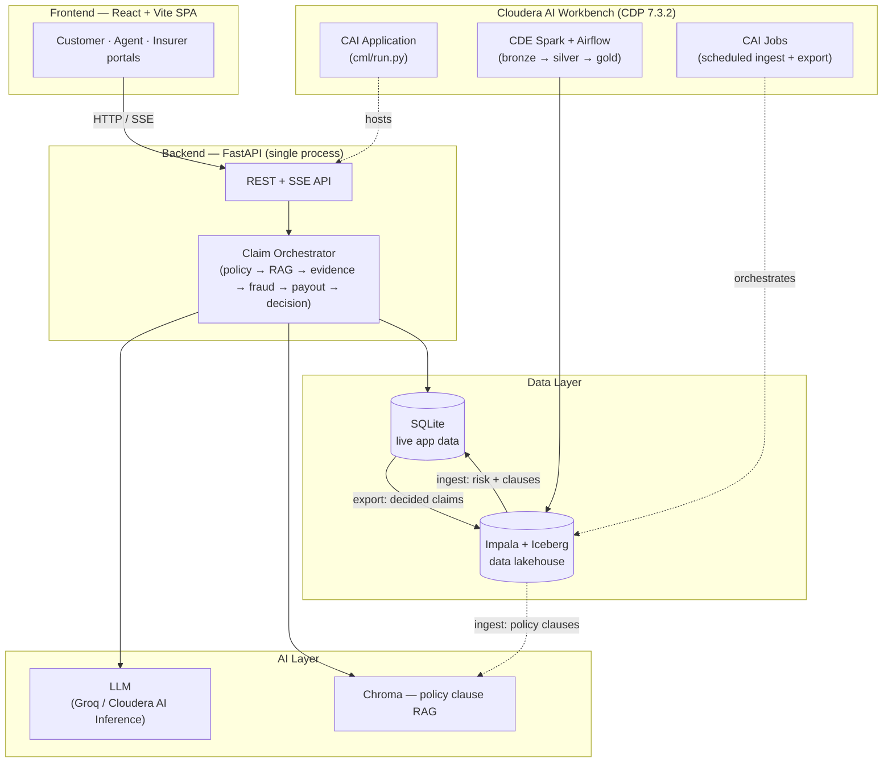

# AI-Powered Motor Vehicle Insurance Claim Processing System

Production-grade **motor-vehicle** insurance claim processing with FastAPI, Celery, Redis, Impala (CDP), Chroma RAG, motor-tuned fraud detection, own-damage / third-party payout split, total-loss detection, and a Confidence & Explainability Layer.

## System Architecture

A simple, layer-by-layer view — from the browser down to the data platform:



- **Frontend + Backend** are the always-on core — works standalone on `DB_BACKEND=sqlite`, no CDP needed (Docker/Local/plain CAI Workbench).
- **AI Layer** powers claim decisions and the policy/copilot chat (Groq or a Cloudera AI Inference endpoint).
- **Data Layer + CDP row** are optional, additive "datalakehouse" phases — only relevant on a full CDP 7.3.2 workspace with CAI↔CDE/CDW/CDF integration (see [Data Lakehouse](#data-lakehouse-impala--iceberg--cde) below). The `OLTP ⇄ Lake` arrows are a real two-way loop: lakehouse risk analytics flow into the app (`ingest`), and app-filed claims flow back into the same analytics (`export-claims`) — not just a one-way demo.

## Claim Decision Pipeline

```
User → API Gateway (FastAPI) → Claim Orchestrator (Celery + Redis)
  → Parallel: Policy Validation | RAG Retrieval | Customer Profile | Evidence | Fraud
  → Decision Engine → Payout Calculation → Explainability Layer
  → Auto Approve/Reject | Human Review | Audit Log
```

## Quick Start (Docker)

```bash
cp backend/.env.example backend/.env
docker compose up --build
```

- API: http://localhost:8000/docs
- Frontend: http://localhost:5173
- Demo login: `test@example.com` / `password123` / OTP: `112233`

## Quick Start (Local)

```bash
cp backend/.env.example backend/.env
cp frontend/.env.example frontend/.env
chmod +x start.sh
./start.sh
```

- API: http://localhost:8000/docs
- Frontend: http://localhost:5173
- Demo login: `test@example.com` / `password123` / OTP: `112233`

Optional: `START_CELERY=1 ./start.sh` if Redis is running. For Docker: `./start.sh docker`

## Quick Start (Cloudera AI / CML)

Everything needed to run this on a Cloudera AI Workbench Session or as a
Cloudera AI Application lives in [`cml/`](cml/README.md), driven through one
dispatcher:

```bash
bash cml/cli.sh doctor       # preflight checks — tools, .env sanity
bash cml/cli.sh setup        # bootstrap: uv/deps, .env, DB, seed, RAG index, SPA build
bash cml/cli.sh start --bg   # launch, detached so the terminal stays free
bash cml/cli.sh smoke        # verify /health, /api/version, /api/llm/health
bash cml/cli.sh logs -f      # watch it
bash cml/cli.sh stop         # when done testing
```

`setup` produces `backend/.venv` and a built `frontend/dist` that FastAPI
serves same-origin — one process, one URL, for both the UI and the API. Once
verified, deploy for real via **Applications → New Application → Script:
`cml/run.py`** (Cloudera manages that process's lifecycle; `cml/cli.sh`'s
`start`/`stop`/`status`/`logs` are for Session-terminal testing only). See
[`cml/README.md`](cml/README.md#as-a-cloudera-ai-application) for the exact
field-by-field walkthrough (screenshot included) of the Create Application form.

To update after pulling new commits: `bash cml/cli.sh update`. If something
breaks and you want one file to share for debugging: `bash cml/cli.sh diagnose`.
See [`cml/README.md`](cml/README.md) for the full command reference and gotchas
(port conflicts with `CDSW_APP_PORT`, Node/Python runtime requirements, Impala
Kerberos/LDAP auth, etc).

## Data Lakehouse (Impala + Iceberg + CDE)

The app's live OLTP data always stays on SQLite (`DB_BACKEND=sqlite`) — it's
not built for a web app's per-request read/write traffic. Separately, a full
**datalakehouse** is built on the same CDP cluster using Impala/Iceberg, to
demonstrate that story without touching the live app's database:

1. **Iceberg schema** (`insurance_lakehouse.policy_master` / `policy_clauses`),
   hand-seeded or pipeline-produced.
2. **CDE Spark medallion pipeline** (bronze → silver → gold), orchestrated
   with Airflow, plus a claims-analytics extension computing per-policy
   `fraud_risk_score` / `claim_risk_band` over an ~800-policy synthetic
   claims-history population.
3. **App-side ingestion** pulling those gold tables back into the app's
   SQLite DB + Chroma RAG index.
4. **Insurer-facing risk UI** — a **Book of Business** page and a **Claim
   Insights risk card** surfacing the ingested `fraud_risk_score` /
   `claim_risk_band`, plus a CAI **Job** to keep step 3 refreshed on a
   schedule instead of a manual re-run.
5. **Closing the loop** — claims actually filed through the running app feed
   back into the same analytics too (a dedicated `app_claims_raw` bronze
   table, unioned into the pipeline before step 3's fraud/risk scoring), not
   just the synthetic claims-history population from step 2.

```bash
bash cml/cli.sh lakehouse seed|verify|ingest|export-claims  # Phases 1, 3 & 5, from a CAI Session
bash cml/cli.sh verify-phase4                               # Phase 4 — insurer risk UI, end-to-end
```

See [`cml/README.md`](cml/README.md) (§ Data lakehouse) for Phases 1, 3 & 4,
and [`cde/README.md`](cde/README.md) for the CDE Spark/Airflow pipeline
(Phase 2).

> **Prerequisite:** Phases 1–4 need a full **CDP 7.3.2** workspace where
> Cloudera AI (CAI) is integrated with CDE/CDW/CDF (i.e. Impala + Iceberg +
> Spark/Airflow are reachable). A **standalone** CAI workspace — no
> CDE/CDW/CDF integration, e.g. a plain Cloudera AI Workbench (AWC) release —
> can't run any of this; just skip the whole Data Lakehouse section and run
> the core app with `DB_BACKEND=sqlite` (the default) for an OLTP-only demo.

## API Endpoints

| Method | Path | Description |
|--------|------|-------------|
| POST | `/api/claims/submit` | Submit claim with documents (multipart) |
| GET | `/api/claims/{id}/status` | Claim status + decision summary |
| POST | `/api/claims/{id}/documents` | Upload supplemental documents |
| POST | `/api/claims/{id}/review` | Human review decision |
| GET | `/api/claims/{id}/audit` | Regulator-ready audit report |
| GET | `/api/policies/{policy_number}/summary` | Policy details |
| GET | `/api/version` | Build marker, DB backend, active LLM provider/model |
| GET | `/api/llm/health` | Live LLM diagnostic (pings the active model) |
| GET | `/health` | Liveness check |

## Decision Output Format

```json
{
  "claim_id": "CLM12345",
  "status": "APPROVED",
  "payable_amount": 125000,
  "own_damage_payable": 100000,
  "third_party_payable": 0,
  "gst_amount": 22500,
  "is_total_loss": false,
  "salvage_deduction": 0,
  "next_cycle_ncb_pct": 0,
  "fraud_score": 0.12,
  "confidence_score": 0.91,
  "retrieved_clauses": ["Section 4.2", "Section 7.1"],
  "reasoning": "Motor collision covered under own-damage; deductible and age-based depreciation applied...",
  "human_review_required": false
}
```

## Celery Tasks

- `validate_policy_task`
- `retrieve_policy_clauses_task`
- `analyze_evidence_task`
- `fraud_detection_task`
- `calculate_payout_task`
- `generate_decision_task`
- `notify_customer_task`

Only used when `CLAIM_PROCESSING_MODE=celery` (Docker Compose). On Cloudera AI
use `CLAIM_PROCESSING_MODE=sync` (the `cml/` automation sets this by default)
so the pipeline runs in-process without Redis/Celery.

## Running Tests

```bash
cd backend
pytest tests/ -v
```

## Project Structure

```
backend/
├── models/          # SQLAlchemy models (10 entities)
├── services/        # AI agents & business logic
├── tasks/           # Celery task definitions
├── routers/         # FastAPI endpoints
├── scripts/         # Seed, DB connection test, Chroma ingest
└── tests/           # Unit tests
frontend/            # React + Vite UI
cml/                 # Cloudera AI (Workbench/CML) automation — see cml/README.md
cde/                 # CDE Spark medallion pipeline (datalakehouse) — see cde/README.md
```

## Environment Variables

See [`backend/.env.example`](backend/.env.example) and
[`docs/env-reference.md`](docs/env-reference.md) for the full list. Key settings:

| Variable | Where | Purpose |
|----------|-------|---------|
| `DB_BACKEND` | backend | `sqlite` (default, local) or `impala` (CDP Data Warehouse) |
| `LAKEHOUSE_DATABASE` | backend | Iceberg schema for the datalakehouse story (default `insurance_lakehouse`) — independent of `DB_BACKEND`, see below |
| `GROQ_API_KEY` | backend | Groq API key for LLM agents in claim flow |
| `GROQ_MODEL` | backend | Default: `openai/gpt-oss-120b` (Production tier — Preview-tier models like `qwen/qwen3.6-27b` may 404 depending on your key's access) |
| `ENDPOINT` / `API_KEY` / `LLM_MODEL` | backend | Custom OpenAI-compatible endpoint (e.g. Cloudera AI Inference) — used instead of Groq when both are set; preferred on CML where `api.groq.com` is often blocked |
| `CLAIM_PROCESSING_MODE` | backend | `sync` (local/CML, no Redis needed), `celery` (Docker), or `auto` |
| `SERVE_FRONTEND` | backend | Serve the built `frontend/dist` from FastAPI (single same-origin deploy) |
| `ROOT_PATH` | backend | Set only behind a Session **PORTS** proxy, e.g. `/proxy/7878`. Leave empty for a real CAI Application (clean subdomain — absolute asset paths don't survive a path-prefix proxy) |
| `CORS_ORIGINS` | backend | Comma-separated frontend URLs allowed to call the API |
| `VITE_API_URL` | frontend | Backend base URL; leave empty for same-origin (CML Application), set only when the frontend is hosted separately (e.g. Vercel) |

### Cloudera AI deployment — two supported layouts

**A. Single CML Application (recommended)** — FastAPI serves the built SPA
same-origin, one URL for everything. This is what [`cml/`](cml/README.md)
automates: run `bash cml/cli.sh setup` in a Session, then point an
Application's Script at `cml/run.py`. `backend/.env`:
```env
DB_BACKEND=sqlite              # or impala, see below
CLAIM_PROCESSING_MODE=sync
SERVE_FRONTEND=true
ROOT_PATH=                     # leave empty — Applications get a clean subdomain
CORS_ORIGINS=https://<your-app>.<workspace>.cloudera.site
GROQ_API_KEY=your-key          # or ENDPOINT/API_KEY for Cloudera AI Inference
```

**B. Split: backend on CML Session + frontend on Vercel** — useful if you
want the frontend on its own CDN/domain. Backend `backend/.env`:
```env
DB_BACKEND=impala
IMPALA_HOST=go01-aws-rtdm-gateway.go01-dem.ylcu-atmi.cloudera.site
IMPALA_PORT=443
IMPALA_USE_SSL=true
IMPALA_AUTH_MECHANISM=GSSAPI
IMPALA_USE_HTTP_TRANSPORT=true
IMPALA_HTTP_PATH=go01-aws-rtdm/cdp-proxy-api/impala
ROOT_PATH=/proxy/7878          # required here — exposed via the Session PORTS proxy
CORS_ORIGINS=https://icn-agents.vercel.app,http://localhost:5173
CLAIM_PROCESSING_MODE=sync
GROQ_API_KEY=your-key
```

Frontend (Vercel → Settings → Environment Variables):
```env
VITE_API_URL=https://YOUR-SESSION.ml-....cloudera.site/proxy/7878
```

Use the exact proxy URL from the CML **PORTS** tab (no trailing slash). Restart the backend after changing `.env`.

### Test the DB connection (SQLite or Impala, local or CML)

```bash
cd backend
cp .env.example .env   # set DB_BACKEND + IMPALA_* vars if using Impala
pip install -e ".[dev]"
python scripts/test_db_connection.py
python scripts/test_db_connection.py --query "SHOW DATABASES"
```

For **LDAP** auth when Kerberos is unavailable locally, set in `backend/.env`:

```env
IMPALA_AUTH_MECHANISM=LDAP
IMPALA_USER=your-workload-username
IMPALA_PASSWORD=your-password
```

With GSSAPI (the default), run `kinit` in the session before connecting.

## Live Claim Processing

After submitting a claim, open the track page — it connects to `GET /api/claims/{id}/stream` (SSE) and shows each agent step live:

1. Policy Validation → 2. RAG Retrieval → 3. Customer Profile → 4. Evidence → 5. Fraud → 6. LLM Decision → 7. Payout

Use `CLAIM_PROCESSING_MODE=sync` on CML so the pipeline runs in-process without Celery.
