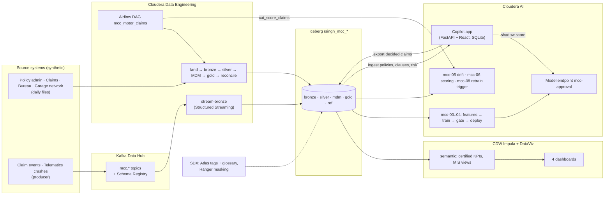

# AI-Powered Motor Vehicle Insurance Claim Processing System

Production-grade **motor-vehicle** insurance claim processing: FastAPI, React, Chroma RAG,
motor-tuned fraud detection, own-damage / third-party payout split, total-loss detection and a
Confidence & Explainability Layer. On Cloudera it is extended into **Motor Claim Copilot
("mcc")**: a governed claims lakehouse, a trained approval and fraud model on Cloudera AI, and
the Copilot app scoring every claim with that model in shadow mode.

- [Deployments at a glance](#deployments-at-a-glance)
- [Motor Claim Copilot on Cloudera (mcc)](#motor-claim-copilot-on-cloudera-mcc): status,
  architecture, build and operate
- [The Copilot app](#the-copilot-app): quick starts, claim pipeline, API, environment
- [go01 lakehouse (earlier deployment)](#go01-lakehouse-earlier-deployment)
- [Repository layout](#repository-layout), [Tests and CI](#tests-and-ci),
  [Documentation](#documentation)

## Deployments at a glance

The same app runs in four places. The mcc work added files but changed no default, so the
earlier deployments behave exactly as before.

| Where | What runs | Data | Start here |
|-------|-----------|------|------------|
| Laptop / Docker | The app only | SQLite | [Quick start](#quick-start-local-or-docker) |
| Cloudera AI Workbench, standalone (AWC) | The app as a CAI Application | SQLite | [`cml/README.md`](cml/README.md) |
| go01 (`go01-aws-rtdm`) | The app + the `insurance_lakehouse` pipeline (CDE, `rsingh-insurance-*`) | SQLite + Iceberg | [go01 lakehouse](#go01-lakehouse-earlier-deployment), [`cde/README.md`](cde/README.md) |
| **federal (`federal-cdp-env`)** | **Motor Claim Copilot: full lakehouse, streaming, ML, governance, the app** | SQLite + Iceberg `rsingh_mcc_*` | [mcc](#motor-claim-copilot-on-cloudera-mcc), [`docs/DEMO_RUNBOOK.md`](docs/DEMO_RUNBOOK.md) |

## Motor Claim Copilot on Cloudera (mcc)

### Status

Live on `federal-cdp-env` and merged to `main`. The plan is [`PLAN.md`](PLAN.md); every live
action is in [`docs/PROJECT_LOG.md`](docs/PROJECT_LOG.md); files copied from sibling projects
are in [`docs/REUSE_INVENTORY.md`](docs/REUSE_INVENTORY.md); links, logins and the demo flow
are in [`docs/DEMO_RUNBOOK.md`](docs/DEMO_RUNBOOK.md).

| Layer | State | Where |
|-------|-------|-------|
| Sources and landing | 5 synthetic source systems (policy admin, claims, credit bureau, garage network, telematics) with planted faults | `generators/`, `contracts/`, CDE `rsingh-mcc-land` |
| Bronze, silver, MDM, gold | Iceberg `rsingh_mcc_*`; load audit, quarantine, reconciliation; golden customer and vehicle cross-reference | `cde/jobs/`, CDE `rsingh-mcc-*` |
| Streaming | Kafka `mcc.claim.events`, `mcc.telematics.crash`, `mcc.control` (schemas in Schema Registry) → `rsingh-mcc-stream-bronze`, checkpointed | `stream/`, `cde/scripts/mcc_deploy_streaming.sh` |
| Orchestration | Airflow DAG `mcc_motor_claims` (CDE job `rsingh-mcc-orchestration`), unpaused; one business date per run, ending with CAI scoring | `cde/dags/mcc_dag.py` |
| Semantic and dashboards | Certified KPIs: straight-through rate, claim cycle time, loss ratio; 4 dashboards in DataViz workspace "MCC - Insurance Claim Processing" | `sql/semantic/`, `config/kpi.json`, `dataviz/build_dashboard.py` |
| ML | Approval and fraud heads, KPI gate, champion on endpoint `mcc-approval`, batch scoring, nightly drift, retrain trigger | `features/`, `train/`, `gate/`, `serve/`, `monitor/`, CAI jobs `mcc-00`..`mcc-08` |
| Guardrails | Input checks, out-of-distribution abstain, output bands; PII redaction and grounding check on the LLM | `guardrails/`, `backend/services/llm_guard.py` |
| App | Copilot as a CAI Application; the model scores in shadow (never changes a decision), shown to insurers and agents only | `cml/launch_app.py`, `backend/services/approval_model_service.py` |
| Governance | Atlas `MCC_SENSITIVE_*` on 82 columns, glossary "MCC Claims KPIs", Ranger tag masking for `federal01` | `scripts/governance.py`, `config/governance.json` |
| Operations | status, stop and start at project scope | `scripts/platform_ctl.py`, `config/platform.json` |
| CI/CD | `CI` (tests, the whole pipeline on local Spark, backend, SPA) and `mcc-approval-mlops` (push → train → gate → deploy on CAI) | `.github/workflows/` |

Last end-to-end run: business date 2026-10-17 through the DAG (land → bronze → silver → MDM →
gold → reconcile → CAI scoring) in 10 minutes; reconciliation 19 matched, 3 explained, 0
mismatched; 142 claims scored.

Known and deferred: the loss ratio is about 576% (the synthetic book is claim-dense); the
nightly drift check reports ALERT until its reference is regenerated at about 6 claims a day.
Before the first scheduled DAG run that does work (2026-10-19 20:30 UTC) stop the long-running
`rsingh-mcc-stream-bronze`: that run replays the day's stream itself.

### Architecture



### Build and operate

Credentials live only in the git-ignored repo-root `.env` (template:
[`.env.example`](.env.example)); load them with `set -a; source .env; set +a`. The repo is
private, so the CAI project is blank and code is pushed into it (`ci/push_files.py` writes
`CODE_VERSION`), and CDE runs from the files resource `rsingh-mcc-code`.

```bash
# Lakehouse (CDE)
./cde/scripts/mcc_deploy_code.sh && ./cde/scripts/mcc_deploy_jobs.sh   # code + Spark jobs
./cde/scripts/mcc_deploy_streaming.sh create|start|stop|restart|status  # the bronze stream
python -m stream.producer.topics --create-topics --register-schemas     # Kafka topics + schemas
./cde/scripts/mcc_deploy_dag.sh && python cde/scripts/set_airflow_variables.py
# manual run: Airflow UI → mcc_motor_claims → Trigger DAG w/ config {"business_date": "2026-10-17"}

# Semantic layer, dashboards, governance
python scripts/run_semantic.py --engine impala --steps views,check,adhoc
python dataviz/build_dashboard.py --import --connection federal-impala-1
python scripts/governance.py            # plan; then: apply, verify

# Cloudera AI: project, jobs, the training chain, the app
python ci/setup_cai.py && python ci/push_files.py --all
python ci/setup_cai.py --run mcc-00-sync-code       # chain mcc-00 → mcc-04
python ci/setup_cai.py --app                        # "MCC Motor Claim Copilot"

# Operations
python scripts/platform_ctl.py status               # always first; then stop / start
python scripts/fetch_dataset.py                     # public benchmark fraud_oracle.csv (Kaggle, pinned)
```

Everything also runs on a laptop with local Spark + Iceberg, which is what CI does:

```bash
pip install -r requirements-ci.txt
python scripts/run_local.py all && python scripts/run_local.py semantic
```

## The Copilot app

### Quick start (local or Docker)

```bash
cp backend/.env.example backend/.env
cp frontend/.env.example frontend/.env
./start.sh                       # SQLite, no Redis; START_CELERY=1 if Redis runs; ./start.sh docker
# or
docker compose up --build        # Redis + API + Celery worker + frontend
```

- API: http://localhost:8000/docs · Frontend: http://localhost:5173
- Demo logins (seed data, OTP `112233` where asked): customer `test@example.com`, agents
  `expert1@claimcopilot.in` / `expert2@claimcopilot.in`, insurer `insurer1@claimcopilot.in`;
  password `password123` for all. Portals: `/auth`, `/agent/auth`, `/insurer/auth`.

### On Cloudera AI

- **federal (mcc):** the app is the CAI Application "MCC Motor Claim Copilot", script
  `cml/launch_app.py`, built by job `mcc-09-app-setup`. Its settings (`DB_BACKEND`,
  `LAKEHOUSE_*`, `IMPALA_*`, `APPROVAL_MODEL_*`) are in the CAI project environment, set by
  `ci/setup_cai.py`; the SPA is built on a laptop and uploaded (`ci/push_files.py --dist`),
  because the workbench cannot reach the Node installer.
- **go01 / AWC:** a Session runs `bash cml/cli.sh setup`, then an Application runs
  `cml/run.py` with settings in `backend/.env`. See [`cml/README.md`](cml/README.md) for
  every command and the Create Application form, field by field.

### Claim decision pipeline

```
User → API (FastAPI) → Claim Orchestrator (in-process, or Celery + Redis)
  → Policy validation | RAG retrieval | Customer profile + Trust Score | Evidence | Fraud
  → Decision engine → Payout calculation → Explainability layer
  → Auto approve / reject | Human review | Audit log
  → (mcc, shadow) approval model score, stored with the claim; never changes the decision
```

After submitting a claim, the track page follows `GET /api/claims/{id}/stream` (SSE) and shows
each step live: policy validation, RAG retrieval, customer profile, evidence, fraud, LLM
decision, payout.

### API endpoints

| Method | Path | Description |
|--------|------|-------------|
| POST | `/api/claims/submit` | Submit claim with documents (multipart) |
| GET | `/api/claims/{id}/status` | Claim status + decision summary |
| GET | `/api/claims/{id}/stream` | Live pipeline progress (SSE) |
| POST | `/api/claims/{id}/documents` | Upload supplemental documents |
| POST | `/api/claims/{id}/review` | Human review decision |
| GET | `/api/claims/{id}/audit` | Regulator-ready audit report |
| GET | `/api/policies/{policy_number}/summary` | Policy details |
| GET | `/api/insurer/book-of-business` | Lakehouse risk per policy (insurer) |
| GET | `/api/insurer/model-vs-rules` | Shadow model agreement with final decisions (insurer) |
| GET | `/api/version` | Build marker, DB backend, active LLM provider/model |
| GET | `/api/llm/health` | Live LLM diagnostic (pings the active model) |
| GET | `/health` | Liveness check |

### Decision output format

```json
{
  "claim_id": "CLM12345",
  "status": "APPROVED",
  "payable_amount": 125000,
  "own_damage_payable": 100000,
  "third_party_payable": 0,
  "gst_amount": 22500,
  "is_total_loss": false,
  "salvage_deduction": 0,
  "next_cycle_ncb_pct": 0,
  "fraud_score": 0.12,
  "confidence_score": 0.91,
  "retrieved_clauses": ["Section 4.2", "Section 7.1"],
  "reasoning": "Motor collision covered under own-damage; deductible and age-based depreciation applied...",
  "human_review_required": false
}
```

### Celery tasks

`validate_policy_task`, `retrieve_policy_clauses_task`, `analyze_evidence_task`,
`fraud_detection_task`, `calculate_payout_task`, `generate_decision_task`,
`notify_customer_task`. Used only when `CLAIM_PROCESSING_MODE=celery` (Docker Compose). On
Cloudera AI use `CLAIM_PROCESSING_MODE=sync` (the default there): the pipeline runs in-process
without Redis.

### Environment variables

The app reads `backend/.env` (template [`backend/.env.example`](backend/.env.example), full
list in [`docs/env-reference.md`](docs/env-reference.md)); on federal the same keys come from
the CAI project environment. The lakehouse, ML and ops scripts read the repo-root `.env`
(`MCC_*` keys, template [`.env.example`](.env.example)).

| Variable | Purpose |
|----------|---------|
| `DB_BACKEND` | `sqlite` (default; the app's live data) or `impala` (schema-parity checks only) |
| `LAKEHOUSE_DATABASE` | Gold database the app ingests from: `insurance_lakehouse` (go01) or `rsingh_mcc_gold` (federal) |
| `LAKEHOUSE_BRONZE_DATABASE` | Where decided claims are exported; empty = `<LAKEHOUSE_DATABASE>_bronze` (go01) |
| `APPROVAL_MODEL_MODE` | `off` (default) or `shadow`: score each claim after the rules decide |
| `APPROVAL_MODEL_URL` / `APPROVAL_MODEL_ACCESS_KEY` | The `mcc-approval` endpoint and its access key |
| `APPROVAL_MODEL_API_KEY` | Bearer key for an endpoint with authentication; inside CAI `CDSW_APIV2_KEY` is used |
| `GROQ_API_KEY` / `GROQ_MODEL` | Groq LLM (default model `openai/gpt-oss-120b`) |
| `ENDPOINT` / `API_KEY` / `LLM_MODEL` | OpenAI-compatible endpoint (e.g. Cloudera AI Inference), used instead of Groq when set |
| `CLAIM_PROCESSING_MODE` | `sync` (no Redis), `celery` (Docker) or `auto` |
| `SERVE_FRONTEND` | Serve the built `frontend/dist` from FastAPI (one same-origin URL) |
| `ROOT_PATH` | Only behind a Session PORTS proxy, e.g. `/proxy/7878`; empty for a CAI Application |
| `CORS_ORIGINS` | Frontend URLs allowed to call the API |
| `VITE_API_URL` | Frontend: backend base URL; empty for same-origin |

#### Cloudera AI layouts

**A. One CAI Application (recommended).** FastAPI serves the built SPA same-origin:

```env
DB_BACKEND=sqlite
CLAIM_PROCESSING_MODE=sync
SERVE_FRONTEND=true
ROOT_PATH=                     # Applications get a clean subdomain
CORS_ORIGINS=https://<your-app>.<workspace>.cloudera.site
GROQ_API_KEY=your-key          # or ENDPOINT/API_KEY for Cloudera AI Inference
```

**B. Backend in a CAI Session, frontend on Vercel.** Backend `backend/.env`:

```env
DB_BACKEND=impala
IMPALA_HOST=go01-aws-rtdm-gateway.go01-dem.ylcu-atmi.cloudera.site
IMPALA_PORT=443
IMPALA_USE_SSL=true
IMPALA_AUTH_MECHANISM=GSSAPI
IMPALA_USE_HTTP_TRANSPORT=true
IMPALA_HTTP_PATH=go01-aws-rtdm/cdp-proxy-api/impala
ROOT_PATH=/proxy/7878          # required: exposed through the Session PORTS proxy
CORS_ORIGINS=https://icn-agents.vercel.app,http://localhost:5173
CLAIM_PROCESSING_MODE=sync
GROQ_API_KEY=your-key
```

Frontend (Vercel → Settings → Environment Variables):
`VITE_API_URL=https://YOUR-SESSION.ml-....cloudera.site/proxy/7878` (the exact PORTS URL, no
trailing slash). Restart the backend after changing `.env`.

#### Test the database connection

```bash
cd backend
cp .env.example .env   # set DB_BACKEND + IMPALA_* to test Impala
uv sync --extra dev
uv run python scripts/test_db_connection.py
uv run python scripts/test_db_connection.py --query "SHOW DATABASES"
```

With GSSAPI (the default) run `kinit` first; without Kerberos use LDAP:
`IMPALA_AUTH_MECHANISM=LDAP`, `IMPALA_USER`, `IMPALA_PASSWORD`.

## go01 lakehouse (earlier deployment)

Built on go01 before mcc and left untouched. The app's live data stays on SQLite; a separate
Impala/Iceberg lakehouse (`insurance_lakehouse*`) feeds it:

1. **Iceberg schema** (`insurance_lakehouse.policy_master` / `policy_clauses`), hand-seeded or
   pipeline-produced.
2. **CDE Spark medallion pipeline** (bronze → silver → gold, Airflow), plus claims analytics
   computing per-policy `fraud_risk_score` / `claim_risk_band` over ~800 synthetic policies.
3. **App-side ingestion** of the gold tables into SQLite + the Chroma RAG index.
4. **Insurer risk UI**: Book of Business page and the Claim Insights risk card, refreshed by a
   scheduled CAI job.
5. **Closing the loop**: claims filed in the app are exported to `app_claims_raw` and scored
   by the same analytics.
6. **Customer Trust Score**: credit band, driving record, tenure and claims at other insurers
   give an explainable 0-100 score whose tier (PREFERRED / STANDARD / WATCH) scales the
   auto-approval amount limit (×1.5 / ×1 / ×0.5); it changes how fast a valid claim is paid,
   never whether.

```bash
bash cml/cli.sh lakehouse seed|verify|ingest|export-claims  # from a CAI Session
bash cml/cli.sh verify-phase4                               # insurer risk UI, end to end
```

Details: [`cml/README.md`](cml/README.md) (data lakehouse, Customer Trust Score),
[`cde/README.md`](cde/README.md) (the go01 CDE pipeline), and the demo click-through
[`docs/steps-to-demo-execution.md`](docs/steps-to-demo-execution.md).

> Needs a full CDP workspace where CAI reaches CDE and CDW. A standalone CAI workspace (AWC)
> runs only the app on `DB_BACKEND=sqlite`.

## Repository layout

```
backend/            FastAPI app: models, services (claim agents, approval_model_service, llm_guard), routers, scripts, tests
frontend/           React + Vite SPA: customer, agent and insurer portals
cml/                Running the app on Cloudera AI (cli.sh for go01/AWC; launch_app.py for federal) and its jobs
cde/                CDE: mcc jobs (cde/jobs/*.py), mcc DAG and scripts (mcc_*); go01 jobs in generate/ validate/ transform/ curate/
generators/         Synthetic source systems (mcc), with planted faults
contracts/          File and message contracts per source entity (mcc)
stream/             Kafka producer, topics and Avro schemas (mcc)
sql/semantic/       Certified KPI, MIS and dashboard views (mcc)
dataviz/            DataViz dashboards, built and imported by build_dashboard.py (mcc)
features/ train/ gate/ serve/ monitor/ guardrails/ lakehouse/
                    The CAI ML chain: features, training, KPI gate, serving + registry, drift, guardrails, batch scoring (mcc)
ci/                 CAI jobs, project setup, file push, retrain trigger, GitHub trigger
scripts/            run_local, run_semantic, governance, platform_ctl, fetch_dataset, git hooks
config/             lakehouse, pipeline, guardrails, KPIs, governance, platform, streaming, CI overlay
tests/              Lakehouse, ML and ops tests (the backend has its own in backend/tests)
docs/               Runbooks, project log, architecture, diagrams
```

## Tests and CI

```bash
pytest -q                                                    # lakehouse, ML, governance, ops (repo root)
cd backend && uv sync --extra dev && uv run pytest -q        # the app
cd frontend && npm ci && npm run build                       # type check + SPA build
```

GitHub Actions: **CI** runs all three plus the whole pipeline on local Spark + Iceberg for
five business dates with the KPI consistency check; **mcc-approval-mlops** pushes the code to
CAI and follows the training chain (needs the `CAI_URL`, `CAI_API_KEY`, `CAI_PROJECT_ID`
secrets). Known: `test_flow_parity[large_over_threshold]` fails after the other parity cases
(it did before mcc too) and is deselected in CI. A gitleaks pre-commit hook guards secrets
(`scripts/install_hooks.sh`).

## Documentation

[`docs/README.md`](docs/README.md) indexes everything: demo runbooks, project log,
architecture, backend and frontend maps, environment reference and diagrams.
