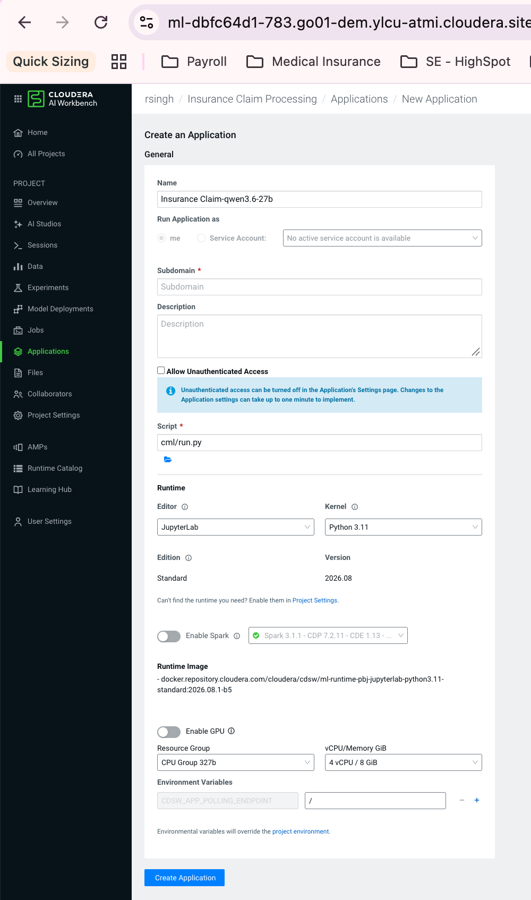

# Cloudera AI (Workbench / CML) automation

Everything is driven through one dispatcher, `cml/cli.sh`. All scripts
auto-detect the repo root, so the clone name doesn't matter.

```
cml/
├── cli.sh       ← single entrypoint — run this
├── lib.sh       ← shared helpers (logging, .env validation, change detection)
├── doctor.sh    ← preflight checks, read-only
├── setup.sh     ← one-shot bootstrap (idempotent, incremental)
├── appctl.sh    ← start/stop/status/logs for Session-terminal testing
├── update.sh    ← git pull + reinstall only what changed
├── reset.sh     ← wipe local demo state (SQLite/Chroma/storage)
├── smoke.sh     ← post-deploy endpoint checks
├── portcheck.sh ← what's listening on a port (no ss/lsof/fuser needed)
├── diagnose.sh  ← bundles doctor+status+portcheck+logs into one shareable file
├── lakehouse.sh ← Iceberg/Impala datalakehouse seed/verify/ingest/export-claims
├── verify_phase4.sh ← insurer risk data served end-to-end check (Phase 4)
├── test_claim.sh ← lakehouse risk -> decision test harness (Phase 4b)
├── jobs/
│   ├── lakehouse_ingest_job.py        ← CML Job wrapper: scheduled lakehouse ingest refresh (Phase 4)
│   └── lakehouse_export_claims_job.py ← CML Job wrapper: scheduled app-claims export (closing the loop)
├── run.py       ← Application launcher (serves UI + API)
├── .state/      ← cached lockfile hashes + app pid/port (gitignored)
└── logs/        ← timestamped run/app logs (gitignored)
```

## Commands

```bash
bash cml/cli.sh doctor              # check tools + .env sanity, no changes
bash cml/cli.sh setup [flags]       # bootstrap: deps, .env, DB, seed, RAG, SPA build
bash cml/cli.sh start [--bg]        # launch — foreground, or detached (--bg)
bash cml/cli.sh stop                # stop a --bg instance
bash cml/cli.sh status              # pid/port + /health check
bash cml/cli.sh logs [-f]           # tail the --bg instance's log
bash cml/cli.sh restart             # stop + start --bg
bash cml/cli.sh smoke [base-url]    # hit /health, /api/health, /api/version, /api/llm/health
bash cml/cli.sh update [--no-pull]  # git pull + reinstall only changed deps + schema check
bash cml/cli.sh reset [--yes]       # delete local demo DB/Chroma/storage
bash cml/cli.sh portcheck [port]    # who's bound to a port + HTTP probe
bash cml/cli.sh diagnose [port]     # one file with doctor+status+portcheck+logs, for sharing
bash cml/cli.sh lakehouse <seed|verify|ingest|export-claims|history|as-of>  # Iceberg/Impala datalakehouse (see below)
bash cml/cli.sh verify-phase4 [--check-claims]  # insurer risk data served end-to-end (see below)
bash cml/cli.sh test-claim <find|submit> [flags]  # lakehouse risk -> decision test harness (see below)
```

`setup` flags: `--skip-frontend` `--skip-seed` `--reset-db` `--run`

### First run in a Session terminal

```bash
bash cml/cli.sh doctor      # see what's missing before you start
bash cml/cli.sh setup       # one-shot bootstrap
bash cml/cli.sh start --bg  # detached — terminal stays free
bash cml/cli.sh smoke       # verify it's up
bash cml/cli.sh logs -f     # watch it live (Ctrl+C just stops watching, not the app)
bash cml/cli.sh stop        # when done testing
```

Hit an error and want to ask for help? `bash cml/cli.sh diagnose` — one file
with everything needed to debug, instead of five separate pastes.

### As a Cloudera AI Application

Prerequisite: run `bash cml/cli.sh setup` once in a Session first, so
`backend/.venv` and `frontend/dist` already exist on disk before the
Application starts (the Application launcher doesn't run `setup` for you).

Then go to **Project → Applications → New Application**:



Fill in exactly this:

| Field | Value |
|---|---|
| **Name** | Anything descriptive, e.g. `Insurance Claim Copilot` |
| **Run Application as** | `me` (default) |
| **Subdomain** *(required)* | Short/unique, e.g. `insurance-claim-copilot` — becomes part of the public URL |
| **Description** | Optional |
| **Allow Unauthenticated Access** | **Check this** — the app has its own login (customer/agent/insurer demo credentials); leaving this unchecked would require separate Cloudera workspace SSO just to reach the page |
| **Script** | `cml/run.py` |
| **Editor / Kernel** | Doesn't matter — leave defaults (e.g. `JupyterLab` / `Python 3.11`). `run.py` execs `backend/.venv/bin/uvicorn` directly, bypassing whatever Python launched it |
| **Edition / Version** | Leave defaults |
| **Enable Spark** | Leave **off** — not used |
| **Enable GPU** | Leave **off** — LLM calls go to a hosted API (Groq / Cloudera AI Inference), no local GPU needed |
| **Resource Group / vCPU/Memory** | `4 vCPU / 8 GiB` is enough for a demo; increase later only if it feels slow |
| **Environment Variables** (`CDSW_APP_POLLING_ENDPOINT`) | Leave as `/` — the FastAPI root serves the SPA `index.html` with a 200, so the default health-poll works. No other env vars needed here — everything (`GROQ_API_KEY`, `DB_BACKEND`, etc.) already lives in `backend/.env` on disk |

Click **Create Application**. First boot can take **10–30+ seconds**
(`crewai`/`langchain`/`chromadb` cold imports — same delay you'll have seen
testing `start --bg` in a Session) before it responds — that's normal, not
a failure.

**Not `cli.sh`/`appctl.sh` for this** — those are for Session-terminal
testing only. The real Application launcher manages the process lifecycle
itself (start, restart on crash, logs in the Application's own Logs tab).

### Ongoing maintenance

- Pulled new commits? Run `bash cml/cli.sh update` — it only reinstalls backend
  or frontend deps if their lockfiles actually changed (hash-cached in
  `cml/.state/`), always rebuilds the SPA and re-checks the DB schema, and
  warns about any new `.env.example` keys your `.env` is missing.
- Want a clean demo? `bash cml/cli.sh reset --yes && bash cml/cli.sh setup --reset-db`
  (SQLite/Chroma/storage only — never touches remote Impala/CDP data).
- Every `setup`/`update` run is logged to `cml/logs/<cmd>-<timestamp>.log` for
  debugging failed runs later.
- `setup` generates a random `JWT_SECRET` the first time it creates `backend/.env`
  (no longer the shared demo placeholder).

## Before you start — edit `backend/.env`

`setup` creates it with safe demo defaults (SQLite, `CLAIM_PROCESSING_MODE=sync`,
`SERVE_FRONTEND=true`). `doctor`/`setup` will keep reminding you if these are
missing. Set at least one LLM provider:

- **Cloudera AI Inference** (recommended on CML — `api.groq.com` is often blocked):
  ```env
  ENDPOINT=https://<host>/namespaces/serving-default/endpoints/<model>/openai/v1
  API_KEY=<cai-inference-key>
  LLM_MODEL=<served-model-id>
  ```
- **Groq**: `GROQ_API_KEY=...`

For the real CDP database instead of SQLite:
```env
DB_BACKEND=impala
IMPALA_HOST=...        # + IMPALA_HTTP_PATH, etc.
# Kerberos: run `kinit` in the session, or use LDAP:
# IMPALA_AUTH_MECHANISM=LDAP / IMPALA_USER / IMPALA_PASSWORD
```
This swaps the app's live OLTP database itself to Impala — not recommended for
this app (see the lakehouse section below for why); it exists mainly so the
schema-parity/`test_db_connection.py` path is available if you ever need it.

## Data lakehouse (Impala + Iceberg) — Phases 1-3

**Why not just put the whole app DB on Impala?** Impala/Iceberg is an
analytical MPP engine — great for BI/ML-style reads over large tables, not
built for a live web app's per-request single-row `INSERT`/`UPDATE` traffic
(auth sessions, claim status changes, chat messages). Per-query latency is
typically hundreds of ms–seconds, not the ~1–5ms SQLite/Postgres give a web
request. So: **the app's OLTP data stays on SQLite** (`DB_BACKEND=sqlite`,
unchanged). Impala/Iceberg is used instead for what it's actually good at —
a separate reference-data lakehouse — to demonstrate the Cloudera
datalakehouse story without breaking the live app.

**Phase 1 (available now):** a small Iceberg schema, hand-seeded, to prove
the plumbing works:

```bash
bash cml/cli.sh lakehouse seed     # creates insurance_lakehouse.{policy_master,policy_clauses}
                                    # (STORED AS ICEBERG) and inserts 3 demo motor policies
                                    # + their clause text — same shape as models/policy.py
bash cml/cli.sh lakehouse verify   # read-only: row counts, confirms STORED AS ICEBERG, sample rows
```

Uses the same `IMPALA_*` connection settings as above (`IMPALA_HOST` etc.) —
if `IMPALA_AUTH_MECHANISM=GSSAPI` (default), run `kinit` in the session first.
Target schema name is `LAKEHOUSE_DATABASE` in `backend/.env` (default
`insurance_lakehouse`). Script: `backend/scripts/lakehouse_seed.py`.

**Phase 2 (available now, separate toolkit):** a real Spark medallion
pipeline (bronze → silver → gold) on Cloudera Data Engineering (CDE),
orchestrated with Airflow, that replaces the hand-seeded rows above with
~60 pipeline-produced ones in the same gold tables, plus a claims-analytics
extension computing per-policy fraud risk scores — see
[`cde/README.md`](../cde/README.md).

**Phase 3 (available now):** an app-side ingestion script that pulls
`policy_master` / `policy_clauses` / `policy_risk_signals` via Impala into
the app's live SQLite DB + Chroma RAG index — so the running app's policy
data actually originates from the lakehouse pipeline, not just provable via
`lakehouse verify`. Additive: never touches the seed.py-generated demo
policies; lakehouse policies (`LH-POL-*`) get their own dedicated customer
accounts.

```bash
bash cml/cli.sh lakehouse ingest          # ingest + index into Chroma
bash cml/cli.sh lakehouse ingest --no-rag # DB only, skip Chroma indexing
```

Script: `backend/scripts/ingest_lakehouse.py`. Idempotent — safe to re-run
after every CDE pipeline run to pick up fresh gold-table data.

**Phase 4 (available now):** an insurer-facing UI on top of the ingested
risk data — a **Book of Business** page (browse/filter/sort all lakehouse
policies by `claim_risk_band`/`fraud_risk_score`) and a **Claim Insights risk
card** (surfaces the same signal, if present, when reviewing a claim). Both
read through one shared query path (`backend/services/policy_risk_service.py`)
so a policy's risk band is always identical in both views.

This closes the loop with a **scheduled refresh** so the data doesn't go
stale between manual `lakehouse ingest` runs: register
[`cml/jobs/lakehouse_ingest_job.py`](jobs/lakehouse_ingest_job.py) as a CML
**Job** (Project → Jobs → New Job → Script: `cml/jobs/lakehouse_ingest_job.py`),
scheduled to run after the CDE Airflow DAG typically completes (e.g. daily).
It's a thin wrapper around `scripts/ingest_lakehouse.py` using the same
robust venv/repo-root resolution as `cml/run.py` — Jobs run independently of
whether the Application is currently up. Test it manually first:
```bash
python cml/jobs/lakehouse_ingest_job.py
```

**Creating the Job** — go to **Project → Jobs → New Job**:

| Field | Value |
|---|---|
| **Name** | Anything descriptive, e.g. `Lakehouse Ingest Refresh` |
| **Run Job as** | `me` (default), unless you have a dedicated service account |
| **Script** | `cml/jobs/lakehouse_ingest_job.py` |
| **Arguments** | Leave empty |
| **Editor / Kernel** | Doesn't matter — leave defaults. The script execs its own Python (`backend/.venv` or `uv run`), bypassing whatever launched it |
| **Edition / Version** | Match whatever your working Session/Application already uses — **not** a GPU edition (see below) |
| **Enable Spark** | Leave **off** — not used |
| **Schedule** | **Manual** first, to test one run; switch to a recurring schedule (e.g. daily) once confirmed, timed to run after your CDE Airflow DAG typically finishes |
| **Enable GPU** | **off** — this is a lightweight DB/RAG-index refresh, no LLM/GPU work happens in this path |
| **Resource Group / vCPU/Memory** | The default (e.g. `2 vCPU / 4 GiB`) is plenty for ~60-policy ingests |
| **Timeout in Minutes** | `10`–`15` is safe |
| **Environment Variables** | Leave empty — it reads `backend/.env` the same way `bash cml/cli.sh lakehouse ingest` does |
| **Job Notifications** | Check at least **Failure**, so a broken scheduled run doesn't go unnoticed |

**Kerberos note**: if `IMPALA_AUTH_MECHANISM=GSSAPI` (the default), an
unattended scheduled Job can't run an interactive `kinit` — you'd need a
keytab-based non-interactive setup instead. If you're on
`IMPALA_AUTH_MECHANISM=LDAP` (`IMPALA_USER`/`IMPALA_PASSWORD` in
`backend/.env`), this doesn't apply — the Job authenticates the same way
`lakehouse ingest` already does from a Session terminal, no ticket needed.

Run it once manually after creating it and check the Job's log — output
should match `bash cml/cli.sh lakehouse ingest` exactly.

**Verifying Phase 4 end-to-end** (data actually served through insurer
auth + the API, not just present in Impala or the app DB):
```bash
bash cml/cli.sh verify-phase4                 # book-of-business + stats only
bash cml/cli.sh verify-phase4 --check-claims  # also look for an existing
                                               # claim tied to an LH-POL-*
                                               # policy
```
Logs in as the demo insurer (`insurer1@claimcopilot.in` / `password123` /
OTP `112233`, from `backend/scripts/seed.py`) and hits
`/api/insurer/book-of-business` + `/stats`. Full JSON is mirrored to a
timestamped file under `cml/logs/` (responses are long).

To see the **Claim Insights risk card** (the other Phase 4 surface — same
risk signal, shown when reviewing an individual claim), you need a claim
against an `LH-POL-*` policy. Those lakehouse-ingested customers get a
placeholder password with no known plaintext, so give one a real password
first:
```bash
cd backend
uv run python scripts/set_demo_password.py --list-lakehouse-customers
uv run python scripts/set_demo_password.py --role customer \
  --email customer50@example.com --password password123
```
Then log in as that customer in the UI (OTP `112233`) and submit a claim
against their `LH-POL-*` policy — the risk card should appear when an
agent/insurer reviews it. **Testing-only**: this rewrites `hashed_password`
directly with no auth/confirmation; never run it against a real user DB.

For the claim wizard's Step 3 (Evidence Upload), which requires at least a
damage photo (+ a driver's licence, since these demo customers aren't
KYC-verified), use the synthetic sample documents in
[`docs/demo-assets/claim-docs/`](../docs/demo-assets/claim-docs/README.md)
(watermarked, not real photos/IDs) instead of hunting for real files.

**Testing that lakehouse risk actually feeds the decision (Phase 4b)** —
instead of hand-typing the password-reset + login + draft + evidence +
submit + poll sequence above every time, use the committed test harness:
```bash
bash cml/cli.sh test-claim find --band HIGH --not-expired   # pick a policy
bash cml/cli.sh test-claim submit --policy-number LH-POL-2059
```
`find` is DB-direct (no running app needed) and lists lakehouse policies
by risk band — pass `--not-expired` to only show policies that pass the
*real* `policy_expired` check (`expiry_date >= now`, status not
EXPIRED/LAPSED/CANCELLED) that `decision_engine.py` runs before it ever
reaches the escalation flags this is meant to test. The `status` column
alone isn't reliable here. `generate_bronze.py`/`lakehouse_seed.py` now
anchor `expiry_date` relative to the job's *run time* (not a fixed
2024-01-01), so re-running `generate-bronze` (CDE) or `lakehouse seed`
(CML) periodically keeps a healthy population of non-expired policies —
see Gotcha in `cde/README.md`. Pass `--no-signal` instead of `--band` to
list *non-lakehouse* policies (no `PolicyRiskSignal` row at all) — useful
for regression-checking that this code path is a true no-op when
`policy.risk_signal is None`. `submit` does the whole flow
against a running app instance (sets the customer's password, logs in,
creates + links + submits a claim using the synthetic evidence docs above,
polls for the decision) and prints the final status, fraud_score, and
escalation flags/messages — so you can confirm `lakehouse_high_risk_policy`
fired and drove the outcome. Script:
[`backend/scripts/lakehouse_risk_claim_test.py`](../backend/scripts/lakehouse_risk_claim_test.py)
(`--help` for all flags). **Testing-only**, same caveat as
`set_demo_password.py` above.

Verified end-to-end in env1 (2026-09-21): a HIGH-band policy
(`LH-POL-2059`) landed on `PENDING_REVIEW` with the
`lakehouse_high_risk_policy` flag and `fraud_score` exactly matching the
`lakehouse_risk_high` weight (0.40); a LOW-band policy (`LH-POL-2000`)
resolved on its own merits with no such flag and no score bump — confirming
the signal is additive and correctly gated by risk band.

## Closing the loop: exporting app claims

Everything above flows lakehouse → app. `bash cml/cli.sh lakehouse ingest`
pulls gold-table data in, but claims actually **filed through the running
app** never fed back into the analytics — `fraud_risk_score` was only ever
computed over the CDE pipeline's synthetic claims history. `export-claims`
closes that loop the other direction:

```bash
bash cml/cli.sh lakehouse export-claims           # export decided claims + mark exported
bash cml/cli.sh lakehouse export-claims --dry-run # preview only, no writes/marking
```

Pushes claims that finished the AI decision pipeline (have a
`ClaimDecision`), are linked to a policy, and haven't been exported yet into
a new Iceberg bronze table (`insurance_lakehouse_bronze.app_claims_raw`) via
Impala — idempotent and incremental (tracked via `claims.lakehouse_exported_at`).
Script: `backend/scripts/export_claims_to_lakehouse.py`. Full design and the
end-to-end data flow: [`cde/README.md`](../cde/README.md#closing-the-loop-exporting-app-claims).

**Creating the scheduled Job** — same walkthrough as the ingest Job above
(§ Creating the Job), just swap:
- **Script**: `cml/jobs/lakehouse_export_claims_job.py`
- **Schedule**: time it to run *before* the CDE claims-analytics pipeline
  (`generate-claims-bronze` → ... → `curate-risk-signals-gold`), so freshly
  exported app claims are included in that run's fraud/risk analytics.

After it runs, re-run `transform-claims-silver` → `curate-risk-signals-gold`
(or the full DAG) in CDE, then `bash cml/cli.sh lakehouse ingest` again to
pull the refreshed `fraud_risk_score` back into the app for any policy with
a newly-exported claim.

## Iceberg time travel / audit (Item 3)

The gold tables (`policy_master`, `policy_clauses`, `policy_risk_signals`,
`garage_risk_signals`) now write via `MERGE INTO` instead of drop+recreate
(see [`cde/README.md`](../cde/README.md#iceberg-time-travel-item-3)), so
every CDE pipeline run commits a real Iceberg snapshot instead of
destroying prior history. `history`/`as-of` are `test-claim`-style
wrappers around the raw `DESCRIBE HISTORY`/`FOR SYSTEM_TIME|VERSION AS OF`
Impala SQL, so you don't have to hand-type it in Hue:

```bash
bash cml/cli.sh lakehouse history --table policy_risk_signals
#   creation_time              snapshot_id            parent_id  is_current_ancestor
#   2026-09-21 11:41:02.199    4967580225782225719    NULL       TRUE
#   2026-09-22 13:53:07.023    6300977543968207922    ...        TRUE

bash cml/cli.sh lakehouse as-of --table policy_risk_signals \
  --policy-number LH-POL-2059 --snapshot 4967580225782225719
# prints the AS OF row, the CURRENT row, and a column-level diff between them
```

`as-of` also accepts `--at '<UTC timestamp>'` instead of `--snapshot`, and
`--garage-name` instead of `--policy-number` for `garage_risk_signals`, or
a raw `--where "..."` fragment for anything else. Script:
[`backend/scripts/lakehouse_time_travel.py`](../backend/scripts/lakehouse_time_travel.py)
(`--help` for all flags).

**Manufacturing a fresh diff on demand** (rather than waiting for a real
day boundary), for rehearsing this demo: `cde/scripts/time_travel_drill.sh`
runs the full CDE generate → validate → transform → curate chain twice —
once seeded as an earlier date, once as today — so `history`/`as-of`
always have two meaningfully different snapshots to show. Run from your
local machine (needs the CDE CLI, not the CAI session):
```bash
./cde/scripts/time_travel_drill.sh              # earlier date defaults to 7 days ago
./cde/scripts/time_travel_drill.sh 2026-09-10   # or pick a specific date
```

Verified end-to-end in env1 (2026-09-22), worked first try: `LH-POL-2059`
was `HIGH`-band (score 69.6, 22 claims) at the prior snapshot and
`MEDIUM`-band (score 36.4, 4 claims) at the current one — both states
real, queryable, and provable via time travel, not just "trust today's
number." `as-of`'s automatic diff caught all 9 changed columns
(`total_claims_count`, `claims_count_12m`, `total_claimed_amount`,
`avg_claim_amount`, `amount_vs_segment_avg_pct`,
`claim_frequency_percentile`, `fraud_risk_score`, `claim_risk_band`,
`ingested_at`) with zero manual comparison needed. This is the actual
audit/regulatory pitch for a bank.

**Ready to actually run this as a demo, top to bottom?** See
[`docs/steps-to-demo-execution.md`](../docs/steps-to-demo-execution.md) for
a click/command runbook covering all 4 beats above in order (assumes
everything is already up and the pipeline has run at least once).

## Customer Trust Score

A 0–100 score, tier, and plain-English reason codes per customer, computed by
[`backend/services/customer_trust_service.py`](../backend/services/customer_trust_service.py)
from `CustomerProfileSignal`. That table holds the credit score, loan
defaults, years licensed, traffic violations, drunk-driving history, claims
at other insurers, tenure, policies held and recent address change. The
score also uses KYC status and the policy's No-Claim Bonus.

| Tier | Score | Effect on the claim decision |
|------|-------|------------------------------|
| PREFERRED | ≥ 82 | Auto-approval amount limit × 1.5 (`TRUST_PREFERRED_AMOUNT_MULTIPLIER`) |
| STANDARD | 60–81 | Unchanged (`HUMAN_REVIEW_AMOUNT_THRESHOLD`, default ₹5,00,000) |
| WATCH | < 60 | Auto-approval amount limit × 0.5 (`TRUST_WATCH_AMOUNT_MULTIPLIER`) |
| UNSCORED | no profile row | Unchanged — exactly the pre-trust-score behaviour |

Thresholds are calibrated against the synthetic 800-customer population:
roughly 35% PREFERRED, 55% STANDARD, 9% WATCH (4–5 WATCH customers among the
60 `LH-POL-*` owners on any given day).

**Design rule: the tier changes how fast a claim moves, never whether a
covered claim is paid.** Nothing in the trust score can produce `REJECTED`. On
top of the tier, two profile patterns become **soft** fraud signals in
`fraud_detection.py`: `financial_stress` (0.15: credit < 600 and a recent
loan default) and `cross_insurer_claims` (0.20: 3+ claims at other insurers
in 3 years). Even stacked (0.35), they stay below the 0.40 review threshold,
so they only matter alongside a real claim-level signal. They are also kept
out of the LLM fraud prompt, because the LLM can only raise the fraud score.
`driver_age` is stored but deliberately not scored, and no protected
attributes exist in the data.

Where the data comes from:
- **Lakehouse customers** (`customer{N}@example.com`, the `LH-POL-*` owners):
  CDE gold table `customer_profile_signals`, pulled in by `bash cml/cli.sh
  lakehouse ingest`. See [`cde/README.md`](../cde/README.md#customer-profile-signals-customer-trust-score).
- **Demo customer** (`test@example.com`): seeded by `scripts/seed.py`
  (credit 781, clean record, so PREFERRED). OLTP-only deployments (env2) get a
  working trust score this way too.

Where it shows up:
- **Claim decision:** `customer_profile` pipeline step. The value used is
  frozen on `claims.customer_trust_json` for audit. When a claim goes to
  human review, the `human_reviews.reason` record ends with
  `[Customer trust: TIER NN/100 — auto-approval limit N]`.
- **Insurer and expert claim review:** a "Customer Trust Score" card in Claim
  Insights showing the score, tier, credit, driving record and top reasons.
- **Never shown to the customer.** The customer-facing decision reasoning
  (including the LLM explanation), live progress feed, insights API and
  audit-report API contain no trust tier or score.
- **Book of Business:** a "Customer trust" column (hover for reasons), a
  trust-tier filter, trust sort, and a Watch-tier stat card.

Time travel works for this table too:
```bash
bash cml/cli.sh lakehouse history --table customer_profile_signals
bash cml/cli.sh lakehouse as-of --table customer_profile_signals \
  --customer-email customer7@example.com --snapshot <id>
```

## Verifying Phase 1-3 end-to-end (step-by-step)

Run this checklist after any `git pull` + `bash cml/cli.sh update` — e.g.
after resuming an idle Session, after a CDE pipeline run, or just to confirm
`main` is in good shape before branching off for new work.

1. **Pull + reinstall changed deps**
   ```bash
   git checkout main && git pull origin main
   bash cml/cli.sh update
   ```
   Watch the output for `[warn] New keys in .env.example not yet in your
   .env: ...` — add any listed keys to `backend/.env` before continuing.

2. **Start the app.** Session terminals can never bind the default
   `CDSW_APP_PORT` (`8090`) — it's permanently owned by the Session's own
   JupyterLab process (see Notes/gotchas below), even though Cloudera
   presets `CDSW_APP_PORT=8090` in a Session terminal's environment too, not
   only in a real Application — so `start`/`restart` always verify the port
   is *actually* free before using it and fall back to `8099` automatically
   if not; no need to set `CDSW_APP_PORT` yourself:
   ```bash
   bash cml/cli.sh restart
   ```
   Expect `[warn] Port 8090 is already in use ... using 8099 instead`
   followed by `[ok] Started (pid ...) — healthy after Ns`. (In a real
   Application's own container, 8090 genuinely is free, so this is a no-op
   there. You can still force a specific port with `CDSW_APP_PORT=<port>
   bash cml/cli.sh restart`.)

3. **Smoke-test it** — no need to pass a URL, it reads back whatever port
   `start`/`restart` actually bound:
   ```bash
   bash cml/cli.sh smoke
   ```
   All five checks should print `[ok]`: `/health`, `/api/health`,
   `/api/version`, `/api/llm/health`, `/`. `/api/version` also echoes the
   current commit (`build`) — compare against `git rev-parse --short HEAD`
   if you want to confirm you're testing exactly what you think you pulled.

4. **(Optional) Confirm the datalakehouse is intact** — Phase 1 seed tables,
   Phase 2/2b CDE gold tables, and Phase 3's ingest into the live app DB:
   ```bash
   bash cml/cli.sh lakehouse verify   # Impala/Iceberg row counts + sample rows
   bash cml/cli.sh lakehouse ingest   # re-pull latest gold tables (idempotent, safe to repeat)
   ```

5. **Stop when done** to free the port (a real Application doesn't need
   this — it runs in its own container):
   ```bash
   bash cml/cli.sh stop
   ```

If any step fails, run `bash cml/cli.sh diagnose` and share the resulting
log file — it bundles `doctor` + `status` + `portcheck` + recent logs into
one file instead of several separate pastes.

## Notes / gotchas

- **Deploy as an Application** (clean subdomain) → leave `ROOT_PATH` empty. Only
  set `ROOT_PATH=/proxy/<port>` if you expose it via a Session **PORTS** proxy
  (absolute `/assets` paths don't survive a path-prefix proxy).
- Keep `UVICORN_WORKERS=1` with SQLite and for SSE claim streaming.
- **`CDSW_APP_PORT` (e.g. `8090`) is permanently owned by the Session's own
  JupyterLab/editor process** — confirmed via `portcheck`: the port is bound
  by `jupyter-lab ... --port=8090`, not a placeholder. You cannot bind it
  from a Session terminal, ever, for the life of that Session. This is
  expected and harmless — a real CAI **Application** runs in its own
  separate container (no Jupyter), so `CDSW_APP_PORT` binds fine there.
  Note Cloudera presets `CDSW_APP_PORT=8090` in a Session terminal's own
  environment too (not just a real Application's), so "is it explicitly
  set?" can't tell the two apart — `start`/`restart` handle this
  automatically now via `pick_app_port()` (in `cml/lib.sh`), which always
  verifies the requested port is *actually* free (reads `/proc/net/tcp`,
  same method as `portcheck`) before using it, falling back to `8099` (then
  scanning up to `8110`) if it's the well-known busy `8090`, or to the next
  free port above whatever else was requested. `cml/cli.sh smoke` (no args)
  reads that same port back from `cml/.state/app.port`, so the whole
  start→smoke loop needs zero manual port-juggling in a Session terminal.
  Force a specific port
  anytime with `CDSW_APP_PORT=<port> bash cml/cli.sh start --bg`.
- **`ssl.SSLError: [SSL: LIBRARY_HAS_NO_CIPHERS]`** on the first outbound TLS
  call (Impala HTTPS transport, LLM API calls) — even with zero LLM
  configured. Seen on some hardened/FIPS-influenced CML runtimes: an OpenSSL
  config gets picked up (even when `$OPENSSL_CONF` is unset/empty) that
  activates zero cipher suites for the **uv-managed Python** specifically —
  the runtime's own `system python3` is unaffected, confirming it's not a
  network/cert block. `setup`/`update`/`lakehouse`/`start`/`restart` and
  `cml/run.py` all **probe the exact interpreter they're about to run**
  first, and only export `OPENSSL_CONF=/dev/null` (skip loading any
  external config, fall back to OpenSSL's compiled-in defaults) if that
  probe actually fails — a runtime that already works (e.g. GSSAPI/Impala
  succeeding without this) is never touched. Always respects an operator's
  explicit `$OPENSSL_CONF`. If you hit this in a bare one-off outside these
  scripts, prefix the command: `OPENSSL_CONF=/dev/null uv run python ...`.
- **No Node/npm in the runtime?** `setup`/`update` now auto-install Node via
  `nvm` (no root needed — same pattern as `ensure_uv`, everything lives under
  `$HOME/.nvm`). Only falls back to API-only mode (`--skip-frontend`) if that
  install itself fails (e.g. no internet egress) — in that case, host the
  frontend elsewhere (e.g. Vercel) pointed at this backend's Application URL.
- Python is pinned to **3.13** via `uv`; `setup` tries `uv python install 3.13`
  (needs egress). If offline, relax `requires-python` and re-lock, or use a
  runtime/custom-runtime that already has 3.13.
- **Logged in, but every page bounces back to `/auth` right after OTP/login
  succeeds** (login + verify-otp + refresh all return 200 in DevTools, but the
  very next API call 401s with an **empty body** from `server: istio-envoy`,
  not JSON from the app). Root cause: some Cloudera AI workspaces front the
  Application with an Istio ingress running its own JWT `RequestAuthentication`
  check against the standard `Authorization` header (expecting a Knox/OIDC
  SSO token) — it silently rejects our app's own JWT there, before the
  request ever reaches FastAPI, and retrying/refreshing the token can't fix
  it because the token never arrives. Fixed by sending the app's token in a
  custom `X-Auth-Token` header instead (frontend `authHeaders()` /
  `agentAuthHeaders()` / `insurerAuthHeaders()`), which that mesh policy
  doesn't inspect; the backend (`dependencies.py`'s `_extract_token`) reads
  `X-Auth-Token` first and still falls back to `Authorization: Bearer` for
  deployments without such a mesh policy. No `.env`/infra change needed —
  just redeploy the app + rebuilt frontend.

## Ideas not yet automated (tell me if you want these next)

- **Programmatic Application provisioning** via Cloudera's `cmlapi` Python
  client — create/update the Application (script, env vars, subdomain) from
  code instead of the UI. Needs a CML API key + project ID.
- **Alembic-based migrations** instead of the current additive
  create-table/column-heal approach in `db_init.py`.
- **CI smoke test** — run `doctor` + a headless `setup --skip-frontend` in
  GitHub Actions against SQLite to catch breakage before it reaches CML.
